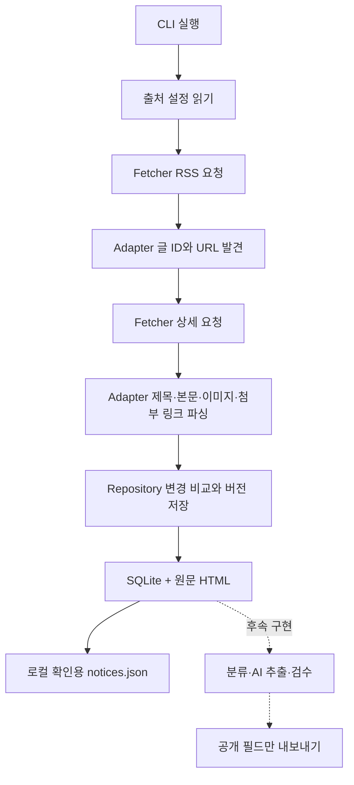

# 명지레이더 수집기 구현 계획

작성일: 2026-11-02

2026-11-04 구조 정리: 실행 코드는 `pipeline/`, 이 문서를 포함한 설계·검증 기록은 `docs/collector/`로 이동했다. 현재 실행법은 [파이프라인 README](../../pipeline/README.md)를 따른다. 아래 구현 시점의 상태·측정 기록은 이후 이슈의 완료 여부와 구분한다.

2026-11-04 #4 구현 반영: 수집 기본 상한은 출처별 50건이며 미수집 글을 우선한다. HTML 고정 공지는 구분해 같은 저장 상태의 일반 글 뒤에서 처리한다. 아래 최초 구현 당시의 3건 기본값 설명은 과거 기록이다.

추가 구현 반영: 공개 게시판 7곳으로 확장했다. 창업교육센터·ABI-X의 비정상 RSS & 보정과 대학혁신지원사업의 HTML 첫 페이지 발견을 구현했다. 현재 상태와 표본 검증은 `추가출처_검증결과.md` 및 README를 우선 참고한다. 아래 단계표는 최초 구현 시점의 계획이다.

규칙 분류·본문 추출 단계도 별도 `analyze` 명령으로 구현했다. 현재 필드와 보류 정책은 `규칙분류_구현결과.md`를 참고한다. 이미지·첨부는 해석하지 않고 사용자 확인 안내를 생성한다.

이 문서는 기존 제안서, 결선 계획, `명지레이더_수집기_설계계획.md`를 바탕으로 오늘 구현할 범위와 이후 확장 순서를 정한다. 기존 설계서는 운영 목표로 유지하고, 이 문서는 실제 코드의 현재 범위를 구분한다.

## 1. 결정

Python CLI 배치 프로그램과 SQLite로 시작한다. 하나의 저장소 안에서 수집, 해석, 검수, 공개 모듈을 분리한다. 지금은 수집과 로컬 확인용 JSON 내보내기까지만 구현한다. AI 분류·추출은 원문을 저장한 뒤 실행하는 후속 단계이며 수집 성공의 선행 조건으로 두지 않는다.

성능보다 원문 보존, 출처 추가, 재실행 안전성, 파서 수정 후 재처리 가능성을 우선한다. Java 서버나 별도 작업 큐는 현재 구현 범위에 필요하지 않다. 운영 API가 필요해지면 수집기를 그대로 두고 읽기 API를 추가한다.

## 2. 현재 구현과 후속 작업

| 단계 | 범위 | 상태 |
| --- | --- | --- |
| 1 | 일반공지·교수학습센터 RSS 발견, 상세 파싱, SQLite·원문 저장, JSON 출력 | 구현 |
| 2 | HTML 목록 탐색, 과거 수집, RSS 장애 대체, 기존 글 재확인 정책 | 후속 |
| 3 | 이미지·첨부 파일 다운로드, 파일 변경 감지, 제한·오류 기록 | 후속 |
| 4 | 나머지 9곳 조사와 어댑터 등록, 예약 실행·중복 실행 잠금·백업 | 후속 |
| 5 | 활동 분류, AI 추출, 근거 대조, 사람 검수, 공개 JSON | 후속 |

현재 프로그램은 운영 자동화가 완료된 서비스가 아니라 실제 파싱을 확인할 수 있는 프로토타입이다. 나머지 9곳의 구조나 RSS 지원을 확인했다고 가정하지 않는다. 기본값은 출처별 3건이며 `--limit 50`까지 지정할 수 있다. RSS가 반환하는 순서대로 처리하므로 첫 항목이 항상 작성일 기준 최신이라고 보장하지 않는다.

## 3. 데이터 흐름과 경계



네트워크 요청은 Fetcher, HTML 해석은 Adapter, 저장은 Repository가 담당한다. 파서는 네트워크나 DB를 직접 사용하지 않아 저장한 HTML로 오프라인 검증할 수 있다. 향후 AI 모듈도 게시판을 직접 방문하지 않고 저장된 원문 버전을 입력으로 받는다.

## 4. 코드 구조

```text
pipeline/
├─ README.md
├─ requirements.txt             # 허용 의존성 범위
├─ requirements.lock.txt        # 이번 실행 환경에서 확인한 버전
├─ config/sources.toml          # 출처·RSS·선택자·허용 호스트
├─ collector/
│  ├─ __main__.py               # 실행 옵션과 단계 연결
│  ├─ models.py                 # Source, NoticeRef, Notice, Adapter 계약
│  ├─ fetcher.py                # HTTP·시간 제한·재시도·요청 간격
│  ├─ repository.py             # DB·원문·버전·실행 기록·JSON 출력
│  └─ adapters/
│     ├─ __init__.py            # 어댑터 등록표
│     └─ k2web.py               # RSS와 상세 HTML 파서
├─ tests/test_collector.py
└─ data/                       # 로컬 생성, Git 제외
   ├─ collector.sqlite3
   ├─ notices.json
   └─ raw/<sha256>.html
```

출처 설정은 `pipeline/config/sources.toml` 하나로 관리한다. `[defaults]`에 공통 선택자를 두고 출처별 값으로 덮어쓴다. Python 표준 라이브러리로 읽을 수 있는 TOML을 사용하며, 중복 YAML 설정은 제거했다. Python 3.11 이상이 필요하고 최초 검증은 Windows Python 3.14.4에서 확인했다.

초기 JSON 출력은 Repository에 포함한다. 공개 필드 가공이나 출력 형식이 늘어나는 시점에 `exporter.py`로 옮긴다. 첫 단계부터 사용할 곳 없는 계층을 추가하지 않는다.

## 5. 저장 모델과 변경 판정

| 테이블 | 목적 | 식별 기준 |
| --- | --- | --- |
| notices | 게시글의 현재 해시·최초/마지막 확인 시각 | source_id + external_id |
| notice_versions | 변경 때마다 파싱 결과·원문 경로·수집 시각 보존 | 증가하는 version ID |
| runs | 실행 시작/완료·출처별 처리 수·실패 URL 기록 | run ID |

K2Web의 external_id는 `site/board/post` 형태다. 고정 공지와 일반 목록에 같은 글이 있어도 한 글로 저장한다. 다른 게시판의 같은 행사 공지는 각각 보관하며 행사 병합은 후속 단계에서 별도로 처리한다.

제목, 본문 텍스트, 이미지 URL·대체 텍스트, 첨부 URL·이름, 파서 버전을 정규 JSON으로 직렬화해 SHA-256 해시를 계산한다. 메뉴·조회수·RSS 날짜 변화는 본문 변경 판정에서 제외한다. 파서 버전이 바뀌면 해석 결과를 다시 확인할 수 있도록 새 버전으로 취급한다.

변경이 없으면 마지막 확인 시각만 갱신하고 버전은 추가하지 않는다. A→B→A로 돌아온 경우에는 세 번의 변경 상태를 모두 남긴다. 원문 HTML은 파일 내용의 해시로 저장해 같은 원문을 중복 보관하지 않는다. 게시글 저장과 버전 저장은 하나의 DB 트랜잭션으로 처리한다.

현재는 HTML이 바뀌어도 파싱 결과가 같으면 새 원문을 보관하지 않는다. 같은 URL의 이미지·첨부 내용 변경 역시 아직 감지하지 않는다. 파일 다운로드 단계에서 파일 해시를 버전 판정에 추가해야 한다.

RSS 작성일은 발견 시점의 메타데이터다. 현재 프로토타입은 상세 페이지 작성일과 대조하지 않으며, 내용 변경이 없으면 버전 JSON의 작성일 메타데이터도 갱신하지 않는다. 마지막 확인 시각은 notices 테이블에서 관리한다.

## 6. 확장하는 방법

### 같은 게시판 계열의 출처 추가

1. 공개 RSS와 상세 글을 실제 확인한다.
2. `sources.toml`에 고유 ID, RSS URL, 허용 호스트, 선택자를 추가한다.
3. `--source 새_ID --limit 3`으로 본문·이미지·첨부를 확인한다.
4. 저장한 HTML 또는 개인정보를 제거한 샘플로 회귀 검증을 추가한다.

### 다른 게시판 계열 추가

`Adapter` 계약의 `discover(xml, source)`와 `parse_detail(html, ref, source)`를 구현하고 `ADAPTERS`에 이름을 등록한다. HTTP·DB 코드를 파서 안에 복제하지 않는다.

현재 discover 계약은 RSS 입력에 맞춰져 있다. HTML 페이지 이동을 구현할 때 `DiscoveryPage(refs, next_request, complete)` 같은 페이지 단위 반환값과 요청 정보를 추가한다. 이를 계기로 RSS와 HTML 발견기를 분리하고, 공통 순회기가 페이지 제한·탐색 완료 여부·커서를 관리한다. 현재 계약만으로 모든 사이트를 지원한다고 가정하지 않는다.

### AI 추출·검수 연결

수집된 `notice_versions.id`를 기준으로 추출한다. 후속 테이블에는 version_id, 모델명, 프롬프트 버전, 결과 JSON, 오류, 실행 시각을 기록한다. 재실행 기준은 `(version_id, 모델 설정, 프롬프트 버전)`으로 두고 수집 데이터와 추출 결과를 섞지 않는다.

사람의 검수도 해당 version_id에 연결한다. 원문 변경 시 이전 검수 결과를 자동 승계하지 않는다. 추출값·사람 수정값·원문 근거를 각각 보관한다.

### DB 변경과 서비스 확대

현재 스키마 버전은 SQLite `user_version=1`이다. 다음 스키마 변경 전에는 순서가 있는 마이그레이션과 DB 백업 절차를 추가한다. 기존 테이블을 삭제해서 새 구조를 만드는 방식은 사용하지 않는다. PostgreSQL 전환 시 Repository의 저장 경계를 교체하고 파서 계약은 유지한다.

## 7. 요청과 오류 처리

현재는 순차 요청, 호스트별 1초 이상 간격, 연결 5초·읽기 20초 제한, 일부 연결 오류·429·5xx에 최대 2회 재시도를 적용한다. HTTP 429의 숫자 Retry-After가 30초 이내면 기다리고, 그 외에는 해당 요청을 실패 처리한다. 날짜 형식 Retry-After의 해석은 후속으로 보완한다.

요청은 출처에 등록된 HTTPS 호스트만 허용하며 리다이렉트마다 검사한다. HTML·RSS 응답은 5MB로 제한한다. 첨부와 외부 신청 링크는 주소만 기록하고 방문하지 않는다. DNS 기반 내부망 주소 검사, 전체 실행 제한 시간, robots 정책 자동 확인은 운영 단계에서 보완한다.

RSS가 비었거나 제목·본문 선택자가 사라지면 성공으로 넘기지 않고 오류를 기록한다. 이미지나 첨부만 있는 공지는 정상적으로 보존한다. 한 글 또는 출처가 실패해도 나머지는 처리하며 하나라도 실패하면 종료 코드는 1이다. 오류 발생 시 이전에 저장한 글을 삭제하지 않는다. 실패 내용은 콘솔과 runs 테이블에 남는다. 강제 종료된 실행은 finished_at이 비어 있을 수 있다.

현재 예약 실행·실행 잠금은 없다. 동시에 여러 수집 명령을 실행하지 않는다. 운영 예약 등록 전에는 프로세스 잠금과 중단된 실행의 정리 절차를 구현한다.

## 8. 단계별 완료 기준

| 단계 | 확인할 결과 |
| --- | --- |
| 실제 파싱 | 두 출처에서 각각 3건 이상 제목·본문·이미지·첨부 링크 확인 |
| 재실행 | 같은 입력 재수집 시 게시글·버전 중복 0건 |
| 변경 기록 | 내용 변경 시 버전 증가, 이전 내용 복원도 이력 보존 |
| 오류 처리 | 빈 RSS·로그인 HTML을 명시적 오류로 처리, 다른 데이터 유지 |
| 11곳 확장 | 출처별 주소·파서 샘플·성공/실패/제외 사유 기록 |
| 운영 전환 | 과거 탐색·재확인·잠금·예약·백업과 복구 확인 |
| AI 연결 | 같은 원문으로 모델·프롬프트별 비교 가능, 검수 상태 분리 |

## 9. 공개 데이터와 로컬 데이터

`data/notices.json`은 개발자가 파싱을 확인하는 내부 출력이다. 대회로 분류하지 않은 일반 공지와 원문 텍스트도 포함하므로 웹에 그대로 배포하지 않는다. DB·원문·JSON은 .gitignore로 제외한다. 공개 단계에서는 허용 필드를 지정한 별도 exporter를 만들어 필요한 요약과 출처 링크만 내보낸다.

검증 결과와 실행법은 README에 기록한다. 실제 사이트 검증 수치는 확인한 두 출처·표본에만 적용하며 11곳 전체의 수집 품질을 의미하지 않는다.
